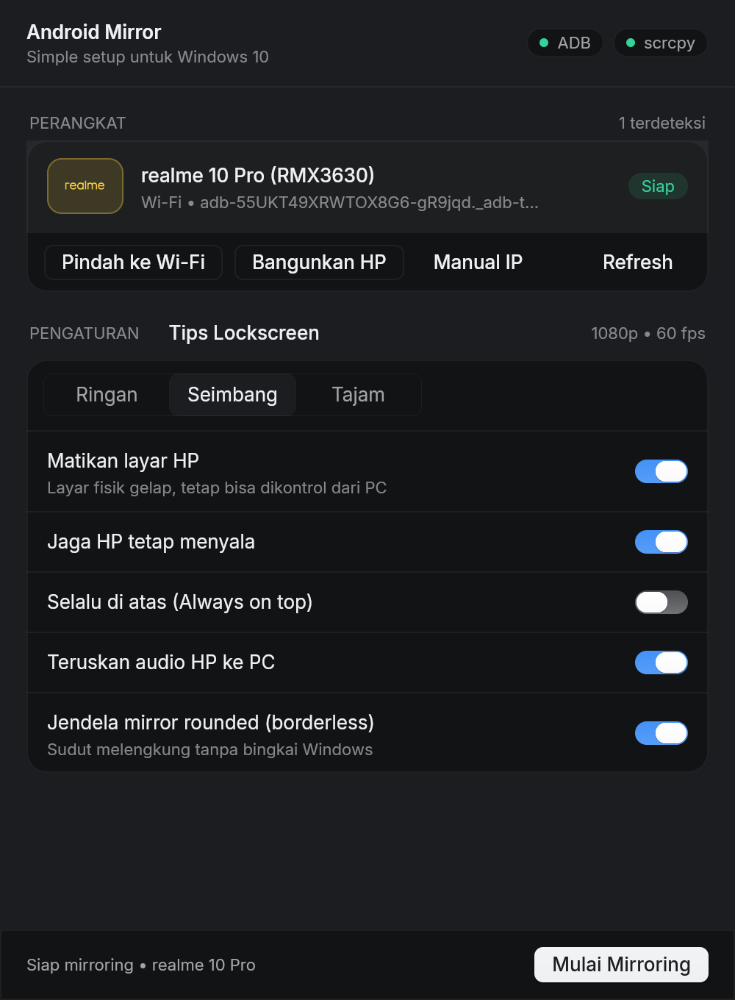

[Bahasa Indonesia](README.md) | English

# Android Mirror

Desktop GUI application for displaying and controlling Android screens over ADB and scrcpy on Windows, Linux, and macOS. It uses Rust and the [Rune](https://github.com/anomalyco/rune) UI framework.

<p align="center">
  
</p>

> Note: The application UI itself is currently in Indonesian. Exact UI labels appear in bold alongside their English explanations below.

## Quick start (Windows)

Download `android-mirror-v0.1.0-windows-x86_64.zip` from [Releases](https://github.com/aqky29/android-mirror/releases), extract the zip archive, and run `android-mirror-app.exe`.

If `scrcpy` or `adb` is not installed on your computer yet, click **Install scrcpy** inside the app window. On Linux and macOS, compile from source using the steps under [Build from source](#build-from-source).

## Features and behavior

### Automatic ADB and scrcpy discovery
On startup, the app checks for `scrcpy` and `adb` inside an adjacent `bin/scrcpy` folder, the user app-data directory, Homebrew paths on macOS (`/opt/homebrew/bin` and `/usr/local/bin`), and the system `PATH`.

Clicking **Install scrcpy** installs both tools according to your OS:

| Operating system | Installation behavior |
| :--- | :--- |
| Windows | Downloads the latest `Genymobile/scrcpy` release from GitHub into `%LOCALAPPDATA%\AndroidMirror\bin\scrcpy`. |
| Linux (`x86_64`) | Downloads the latest `scrcpy-linux-x86_64` tarball into `$XDG_DATA_HOME/android-mirror/bin/scrcpy` or `~/.local/share/android-mirror/bin/scrcpy`. On other architectures, install via your distro package manager such as `sudo apt install scrcpy adb`. |
| macOS | Runs `brew install scrcpy android-platform-tools` via Homebrew. |

### USB connections, Wi-Fi switching, and device telemetry
Connected USB phones appear with brand icons bundled from `assets/brands/*.svg` (supporting Realme, Xiaomi/Redmi, OPPO, Vivo, Samsung, Google/Pixel, OnePlus, Poco, Asus, Honor, Huawei, Motorola, Sony, plus a generic Android icon).

From any connected device card, you can:
- Switch an active USB connection to Wi-Fi in one click using **Pindah ke Wi-Fi** (enables `adb tcpip 5555` and connects to the device Wi-Fi IP), or enter `IP:Port` manually for Android 11+ Wireless Debugging.
- Monitor CPU usage (`%`), GPU usage (`%` when exposed without root), battery percentage, and battery temperature (`°C`).
- Wake the phone screen remotely via **Bangunkan HP** (`KEYCODE_WAKEUP`).

### Quality presets and mirror window options
The `PENGATURAN` section includes three video presets and per-session mirror toggles:

| UI preset | Resolution & FPS | scrcpy flags |
| :--- | :--- | :--- |
| Ringan | `720p`, `30 fps` | `-m 1280 -b 4M --max-fps 30` |
| Seimbang | `1080p`, `60 fps` | `-m 1920 -b 8M --max-fps 60` |
| Tajam | Native resolution, `60 fps` | `-b 16M --max-fps 60` |

Available window and device toggles:
- **Matikan layar HP** (`--turn-screen-off`) blanks the physical phone screen while keeping PC input active.
- **Jaga HP tetap menyala** (`--stay-awake`) prevents the phone from sleeping while connected.
- **Selalu di atas (Always on top)** (`--always-on-top`) keeps the mirror window above other windows.
- **Teruskan audio HP ke PC** forwards device audio by default; turning it off passes `--no-audio`.
- **Jendela mirror rounded (borderless)** on Windows clips the mirror window to rounded corners with a `26 px` top drag bar (minimize and close buttons) synced to Windows Z-order, while the standard mode applies a dark title bar on Windows 10/11. On Linux and macOS, **Jendela mirror borderless** passes `--window-borderless`.

Closing the main window sends the app to the System Tray without stopping running mirror windows. Choosing **Keluar** (Quit) from the tray menu terminates active `scrcpy` child processes before exiting.

## Prerequisites

### Android phone setup
1. Open `Settings > About phone` and tap `Build number` 7 times to enable `Developer options`.
2. Turn on `USB Debugging`.
3. On realme / OPPO (ColorOS) or Xiaomi devices, also enable `Disable permission monitoring` or `USB Debugging (Security Settings)` in Developer options so keyboard/mouse control and clipboard sync work properly.

### Source build dependencies
Install the [Rust toolchain](https://rustup.rs/) (this crate uses Rust edition `2024`) along with platform build tools:
- Windows: Visual Studio C++ Build Tools (MSVC target).
- Linux (Ubuntu/Debian):
  ```sh
  sudo apt-get update
  sudo apt-get install -y pkg-config libxkbcommon-dev libwayland-dev libgl1-mesa-dev libvulkan1
  ```
- macOS: Xcode Command Line Tools (`xcode-select --install`).

## Build from source

```sh
git clone https://github.com/aqky29/android-mirror.git
cd android-mirror
cargo build --release
```

Run the compiled binary:

```sh
# Windows
.\target\release\android-mirror-app.exe

# Linux / macOS
./target/release/android-mirror-app
```

To run in development mode directly, execute `cargo run`.

## Shortcuts and tips

- `scrcpy` handles two-way clipboard synchronization between PC and Android automatically: press `Ctrl + V` in the mirror window to paste text, or `Ctrl + Shift + V` to copy PC clipboard content to the Android clipboard.
- Press `Alt + O` inside the mirror window to turn off the phone screen without locking the device.
- Android blocks capture on lockscreens and certain banking apps (`FLAG_SECURE`), leaving a black screen while locked. Click **Tips Lockscreen** in the app or unlock without seeing the screen using your PC keyboard: press `Space`, type your PIN, and press `Enter`.

## Project structure

```text
android-mirror/
├── .github/workflows/
│   ├── build.yml        # Manual CI build workflow for Windows, Linux, and macOS
│   └── release.yml      # Manual multiplatform release packaging workflow
├── assets/
│   └── brands/          # Device brand SVG icons (embedded by build.rs)
├── docs/
│   ├── preview.png      # Application window screenshot
│   └── prototype.html   # Early HTML/CSS UI prototype
├── src/
│   ├── main.rs          # Rune UI, state, device polling, and System Tray
│   ├── adb.rs           # ADB/scrcpy integration, auto-installer, and telemetry
│   └── win.rs           # Win32 window styling (dark title bar and rounded thin bar)
├── build.rs             # Build script generating embedded brand icon mappings
├── Cargo.toml           # Crate manifest and Rune dependencies
├── Cargo.lock
├── LICENSE
├── README.md
└── README.en.md
```

## License

Available under the [MIT License](LICENSE).
