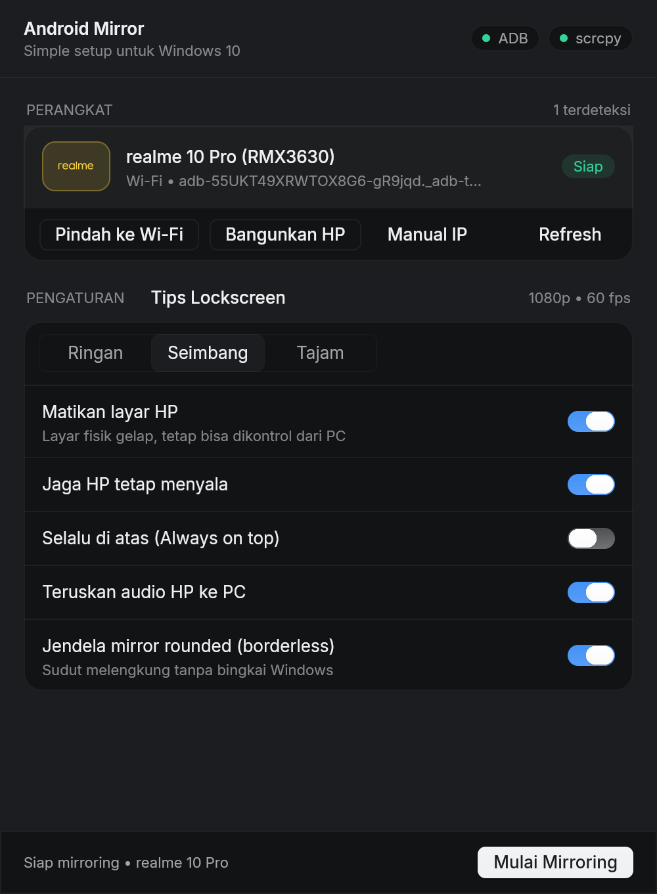

Bahasa Indonesia | [English](README.en.md)

# Android Mirror

Aplikasi desktop untuk menampilkan dan mengontrol layar Android lewat ADB dan scrcpy di Windows, Linux, dan macOS. Aplikasi ini memakai Rust dan framework UI [Rune](https://github.com/anomalyco/rune).

<p align="center">
  
</p>

## Cara cepat memakai (Windows)

Unduh `android-mirror-v0.1.0-windows-x86_64.zip` dari halaman [Releases](https://github.com/aqky29/android-mirror/releases), ekstrak arsipnya, lalu jalankan `android-mirror-app.exe`.

Jika `scrcpy` atau `adb` belum ada di komputer Anda, klik **Install scrcpy** pada jendela aplikasi. Pengguna Linux dan macOS dapat mengompilasi aplikasi dari kode sumber lewat langkah pada bagian [Build dari source](#build-dari-source).

## Fitur dan perilaku aplikasi

### Deteksi dan setup ADB/scrcpy
Saat dibuka, aplikasi mencari biner `scrcpy` dan `adb` di folder `bin/scrcpy` sebelah program, direktori data aplikasi pengguna, jalur Homebrew macOS (`/opt/homebrew/bin` dan `/usr/local/bin`), serta `PATH` sistem.

Saat tombol **Install scrcpy** ditekan, aplikasi menjalankan metode instalasi sesuai sistem operasi:

| Sistem operasi | Tujuan instalasi / perintah |
| :--- | :--- |
| Windows | Mengunduh rilis terbaru `Genymobile/scrcpy` dari GitHub ke `%LOCALAPPDATA%\AndroidMirror\bin\scrcpy`. |
| Linux (`x86_64`) | Mengunduh arsip `scrcpy-linux-x86_64` ke `$XDG_DATA_HOME/android-mirror/bin/scrcpy` atau `~/.local/share/android-mirror/bin/scrcpy`. Untuk arsitektur lain, pasang via manajer paket distro seperti `sudo apt install scrcpy adb`. |
| macOS | Menjalankan `brew install scrcpy android-platform-tools` melalui Homebrew. |

### Koneksi USB, Wi-Fi, dan telemetry perangkat
Perangkat USB yang terhubung tampil beserta ikon merek dari `assets/brands/*.svg` (Realme, Xiaomi/Redmi, OPPO, Vivo, Samsung, Google/Pixel, OnePlus, Poco, Asus, Honor, Huawei, Motorola, Sony, dan ikon Android umum).

Pada kartu perangkat yang terhubung, Anda bisa:
- Memindah koneksi USB ke Wi-Fi dalam satu klik lewat tombol **Pindah ke Wi-Fi** (menjalankan `adb tcpip 5555` lalu menyambung ke IP Wi-Fi ponsel), atau memasukkan `IP:Port` secara manual untuk Wireless Debugging (Android 11+).
- Melihat pemakaian CPU (`%`), GPU (`%` bila sistem Android mengizinkan baca tanpa root), level baterai (`%`), dan suhu baterai (`°C`).
- Menyalakan layar ponsel dari jarak jauh dengan tombol **Bangunkan HP** (`KEYCODE_WAKEUP`).

### Kualitas video dan opsi jendela
Bagian `PENGATURAN` menyediakan tiga preset kualitas serta beberapa opsi kontrol jendela:

| Preset UI | Resolusi & FPS | Flag scrcpy |
| :--- | :--- | :--- |
| Ringan | `720p`, `30 fps` | `-m 1280 -b 4M --max-fps 30` |
| Seimbang | `1080p`, `60 fps` | `-m 1920 -b 8M --max-fps 60` |
| Tajam | Resolusi asli, `60 fps` | `-b 16M --max-fps 60` |

Opsi lain di panel pengaturan:
- **Matikan layar HP** (`--turn-screen-off`) menggelapkan layar fisik ponsel selama kontrol dari PC berlangsung.
- **Jaga HP tetap menyala** (`--stay-awake`) menahan perangkat agar tidak tidur saat terhubung.
- **Selalu di atas (Always on top)** (`--always-on-top`) menjaga jendela mirror berada di atas jendela lain.
- **Teruskan audio HP ke PC** aktif secara bawaan; mematikan opsi ini meneruskan flag `--no-audio`.
- **Jendela mirror rounded (borderless)** di Windows membulatkan sudut jendela dan menambahkan bar seret tipis setinggi `26 px` (lengkap dengan tombol minimize dan close) yang mengikuti Z-order Windows, sementara mode standar memakai dark title bar Windows 10/11. Di Linux dan macOS, opsi **Jendela mirror borderless** meneruskan `--window-borderless`.

Menutup jendela utama mengecilkan aplikasi ke System Tray tanpa memutus sesi `scrcpy`. Memilih **Keluar** pada menu Tray menghentikan seluruh proses `scrcpy` aktif sebelum aplikasi ditutup.

## Prasyarat

### Pengaturan HP Android
1. Buka `Setelan > Tentang ponsel`, lalu ketuk `Nomor Build` 7 kali untuk mengaktifkan `Opsi Pengembang`.
2. Aktifkan `USB Debugging`.
3. Khusus perangkat realme / OPPO (ColorOS) atau Xiaomi, aktifkan juga `Disable permission monitoring` atau `USB Debugging (Security Settings)` di dalam Opsi Pengembang agar kontrol keyboard, mouse, dan sinkronisasi clipboard berjalan normal.

### Dependensi build dari source
Pasang [Rust toolchain](https://rustup.rs/) (crate memakai Rust edition `2024`) serta perkakas sistem masing-masing OS:
- Windows: Visual Studio C++ Build Tools (target MSVC).
- Linux (Ubuntu/Debian):
  ```sh
  sudo apt-get update
  sudo apt-get install -y pkg-config libxkbcommon-dev libwayland-dev libgl1-mesa-dev libvulkan1
  ```
- macOS: Xcode Command Line Tools (`xcode-select --install`).

## Build dari source

```sh
git clone https://github.com/aqky29/android-mirror.git
cd android-mirror
cargo build --release
```

Jalankan binary hasil kompilasi:

```sh
# Windows
.\target\release\android-mirror-app.exe

# Linux / macOS
./target/release/android-mirror-app
```

Untuk langsung menjalankan versi development tanpa build rilis, pakai `cargo run`.

## Shortcut dan tips penggunaan

- `scrcpy` menyinkronkan clipboard antara PC dan Android secara dua arah: tekan `Ctrl + V` di jendela mirror untuk menempel teks, atau `Ctrl + Shift + V` untuk menyalin isi clipboard PC ke clipboard ponsel.
- Tekan `Alt + O` di jendela mirror saat ingin mematikan layar fisik ponsel tanpa menguncinya.
- Android memblokir tampilan layar kunci dan aplikasi perbankan tertentu (`FLAG_SECURE`) sehingga jendela mirror tampak hitam saat lockscreen aktif. Anda dapat membuka panel **Tips Lockscreen** di aplikasi atau mengetik PIN lewat keyboard PC: tekan `Spasi`, ketik PIN Anda, lalu tekan `Enter`.

## Struktur proyek

```text
android-mirror/
├── .github/workflows/
│   ├── build.yml        # Workflow build manual Windows, Linux, dan macOS
│   └── release.yml      # Workflow rilis manual lintas platform
├── assets/
│   └── brands/          # Ikon SVG merek perangkat (di-embed oleh build.rs)
├── docs/
│   ├── preview.png      # Tangkapan layar aplikasi
│   └── prototype.html   # Prototipe antarmuka awal (HTML/CSS)
├── src/
│   ├── main.rs          # Antarmuka Rune, state, polling perangkat, dan System Tray
│   ├── adb.rs           # Integrasi ADB/scrcpy, auto-installer, dan telemetry HP
│   └── win.rs           # Kustomisasi jendela Win32 (dark title bar & rounded thin bar)
├── build.rs             # Script pembuat modul ikon merek saat kompilasi
├── Cargo.toml           # Manifest crate dan dependensi Rune
├── Cargo.lock
├── LICENSE
├── README.md
└── README.en.md
```

## Lisensi

Tersedia di bawah lisensi [MIT](LICENSE).
